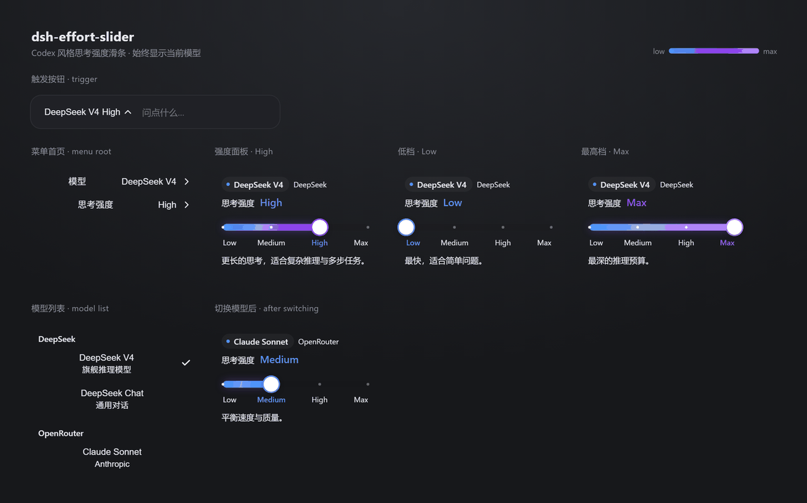

# dsh-effort-slider

[English](#english) · [中文](#中文)

A **Codex-style reasoning-effort slider** for **DeepSeek Harness (DSH)**: it replaces the composer's discrete effort picker with one continuous, **colour-shifting** track — blue at the cool end, violet in the middle, bright lavender at the top. The model the slider is attached to is always on screen: `DeepSeek V4 · High` in the trigger, the live name in the menu, and a model pill above the track.



---

## English

### The colours

Dragging does not merely lengthen a bar; the fill **heats up** as the effort rises:

| Position | Fill's right end | Feel |
|---|---|---|
| low (≤ 1/3) | `#4D93F8` blue | cool |
| middle (1/3 – 2/3) | blue → `#9333EA` violet | warming |
| high (≥ 2/3) | violet → `#C084FC` lavender | hot |

- The fill always starts blue on the left and blends toward the current accent, producing one continuous gradient.
- A glossy **sheen** layer rides on top of the gradient.
- The track is a **10 px pill**; the knob is a **white circle** with a same-colour ring.
- Tick marks and the current-level label **tint with the same ramp** (blue → indigo → lavender).
- The top stop is deliberately a *bright* lavender rather than a deep purple: deep purple is nearly invisible against the dark composer panel.

The palette follows the colour scheme of OpenAI Codex's reasoning-effort slider (`#4d93f8` / `#9333ea` / `#c084fc`, mixing across thirds of the track). Colour values only — no Codex code is included.

### Model display

The model you are driving is always visible, in three places:

- **Trigger** — `DeepSeek V4 · High`: model name first, current effort label after it, so you never open the menu to remember which model the slider is attached to.
- **Menu root** — a `Model` row whose value is the live model name, above the `Effort` row.
- **Effort pane** — a pill at the top carrying the model name, with the provider name beside it, so the slider reads as *"effort for this model"* rather than a detached control. The live level label in that pane is tinted with the same blue → violet ramp as the track.

The name comes straight from the shared `modelDirectories` snapshot (`state.current` → matching model entry), so switching models anywhere in the UI updates the slider immediately — no extra fetch, no cached copy.

### Interaction

- 1:1 pointer dragging; on release the knob snaps to the nearest level and saves.
- Keyboard: ← / → step one level, Home / End jump to the ends.
- The menu stays open so you can fine-tune; a failed save springs the knob back.
- Registered as a `priority: -1` shadow of `conversation.input.model`, so the stock model seat stays as a fallback.

### Install

```sh
# web surface
dsh plugin --profile web add github:SailingBoat-ovo/dsh-effort-slider

# desktop app
dsh plugin --profile desktop add github:SailingBoat-ovo/dsh-effort-slider
```

Or clone and install by path:

```sh
git clone https://github.com/SailingBoat-ovo/dsh-effort-slider
dsh plugin --profile web add ./dsh-effort-slider
```

**Restart DSH afterwards** (restart the app on desktop).

### Screenshot

`preview.png` is generated, not hand-drawn — it is a headless-browser screenshot of a page built from this plugin's own CSS and palette:

```sh
node tests/build-preview.mjs          # writes .preview/preview.html
node tests/measure-preview.mjs        # optional: prints geometry, fails on ragged layout
# then screenshot .preview/preview.html at 1180x760, device scale 2
```

So if a colour or spacing value changes, the README image can be regenerated rather than silently going stale.

### Compatibility

Works on DSH `0.1.x` (web) and `0.2.1+` (desktop).

On 0.2.x, a traced service method rebinds `this.ctx` to the **caller**, and the `modelDirectories` resolver resolves `remote.session` through that context. Without declaring `remote` / `remote.session` in `inject`, the composer seat crashes with:

```
cannot get property "remote.session" without inject
slot entry crashed in 'conversation.input.model'
```

Both are declared here, and the registration uses the 0.2.x form (`ctx.slots.inject(...)` directly).

### Tests

```sh
npm install
npm test
```

Asserts the registration surface, the `remote.session` declaration, that the inject face resolves, that the component renders, that the trigger surfaces the selected model name and effort, and that **the three fill colours really progress with position** (`#4D93F8` → `#7063F1` → `#BF82FB`).

`tests/ui-render.mjs` goes further: it mounts the seat with `react-test-renderer`, clicks the trigger, opens the **Model** and **Effort** rows, and asserts the model name reaches the trigger, the menu row, and the effort pane's model pill (plus the provider hint, the status dot, and its position above the level header).

### License

GPL-3.0-or-later — see [LICENSE](LICENSE) for the full text. Third-party notes in [NOTICE.md](NOTICE.md).

---

## 中文

**DeepSeek Harness（DSH）的 Codex 风格思考强度滑条**：把输入框旁那个一档一档点的强度选择，换成一条连续、**会变色**的轨道——冷端蓝、中段紫罗兰、顶端亮紫。滑条正在调哪个模型始终可见：触发按钮上的 `DeepSeek V4 · High`、菜单里的实时模型名，以及轨道上方的模型药丸。

### 配色

拖动时颜色会随档位**"升温"**，不是单纯的进度条变长：

| 位置 | 填充右端颜色 | 观感 |
|---|---|---|
| 低段（≤ 1/3） | `#4D93F8` 蓝 | 冷 |
| 中段（1/3 ~ 2/3） | 蓝 → `#9333EA` 紫罗兰 | 过渡 |
| 高段（≥ 2/3） | 紫罗兰 → `#C084FC` 亮紫 | 热 |

- 填充始终以蓝为左端、向当前档位颜色过渡，形成一条连续渐变；
- 渐变之上叠一层**高光 sheen**；
- 轨道是 **10px 药丸形**，滑块是**白色圆钮**并带同色描边；
- 刻度点与当前档位文字**同样跟色**（蓝 → 靛紫 → 亮紫）；
- 最高档刻意用**亮紫而非深紫**：深紫在深色面板上几乎看不见。

配色参考了 OpenAI Codex 推理强度滑条（`#4d93f8` / `#9333ea` / `#c084fc`，按轨道前中后三段混合），仅取色值，不含 Codex 代码。

### 模型显示

当前正在调的模型始终可见，共三处：

- **触发按钮** —— `DeepSeek V4 · High`：模型名在前、当前档位在后，不用展开菜单就知道滑条挂在哪个模型上；
- **菜单首页** —— `模型` 一行的值就是实时模型名，位于 `思考强度` 之上；
- **强度面板** —— 顶部一枚药丸标签显示模型名，旁边是 provider 名称，让这根滑条读起来是"这个模型的思考强度"，而不是一个脱离上下文的控件；面板里的档位文字同样跟着蓝 → 紫的渐变取色。

模型名直接取自共享的 `modelDirectories` 快照（`state.current` → 匹配的模型项），所以在界面任何地方切换模型，滑条都会立即跟着变——不额外请求、不缓存副本。

### 交互

- 指针 1:1 跟手拖动；松手吸附到最近档位并保存；
- 键盘 ← / → 逐档，Home / End 跳到两端；
- 菜单保持打开便于连续微调；保存失败会回弹；
- 以 `priority: -1` 影子注册 `conversation.input.model`，原模型座位作为兜底。

### 安装

```sh
# Web 版
dsh plugin --profile web add github:SailingBoat-ovo/dsh-effort-slider

# 桌面应用版
dsh plugin --profile desktop add github:SailingBoat-ovo/dsh-effort-slider
```

或克隆后按路径安装：

```sh
git clone https://github.com/SailingBoat-ovo/dsh-effort-slider
dsh plugin --profile web add ./dsh-effort-slider
```

**装完重启 DSH**（桌面版重启应用）。

### 配图

`preview.png` 不是手画的，而是用插件自己的 CSS 与配色生成页面后，用无头浏览器截的图：

```sh
node tests/build-preview.mjs          # 生成 .preview/preview.html
node tests/measure-preview.mjs        # 可选：打印几何信息，布局参差时报错
# 再以 1180x760、device scale 2 截图
```

所以改了颜色或间距，可以直接重生成配图，而不是让它悄悄过期。

### 兼容性

同时适配 DSH `0.1.x`（Web）与 `0.2.1+`（桌面版）。

在 0.2.x 上，traced 服务方法会把 `this.ctx` 重绑到**调用方**，而 `modelDirectories` 会经由该上下文解析 `remote.session`。若 `inject` 未声明 `remote` / `remote.session`，模型座位会直接崩溃：

```
cannot get property "remote.session" without inject
slot entry crashed in 'conversation.input.model'
```

本插件已声明这两项，并使用 0.2.x 写法（`ctx.slots.inject(...)` 直接注册）。

### 测试

```sh
npm install
npm test
```

覆盖注册面、`remote.session` 声明、注入面可解析、组件渲染、触发按钮显示所选模型名与档位，以及**三档填充颜色确实随位置递进**（`#4D93F8` → `#7063F1` → `#BF82FB`）。

`tests/ui-render.mjs` 更进一步：用 `react-test-renderer` 真实挂载座位，点开触发按钮、进入 **模型** 与 **思考强度**，断言模型名确实出现在触发按钮、菜单行以及强度面板的模型药丸上（另含 provider 提示、状态圆点及其位于档位标题之上的顺序）。

### 许可

GPL-3.0-or-later，完整文本见 [LICENSE](LICENSE)；第三方说明见 [NOTICE.md](NOTICE.md)。